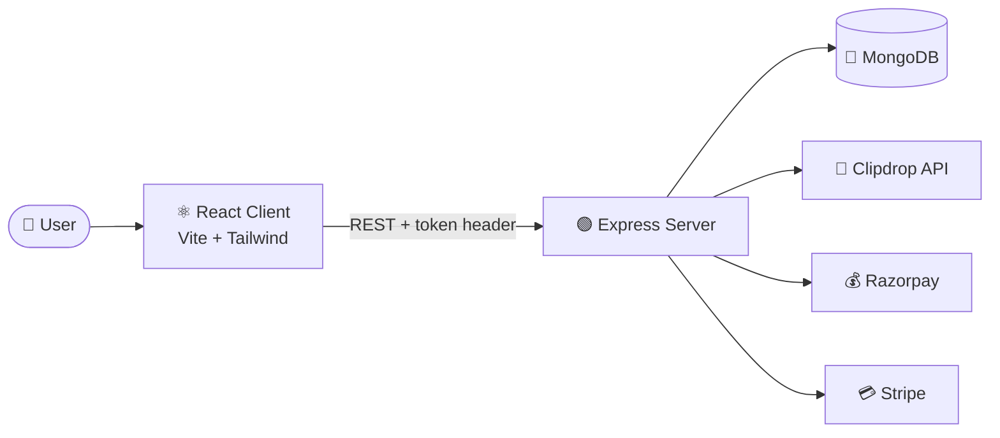
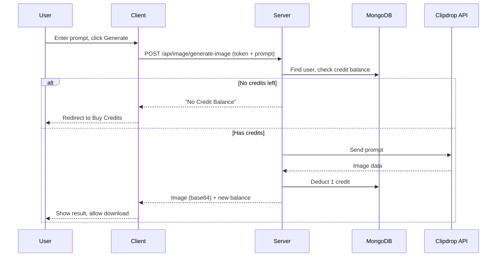
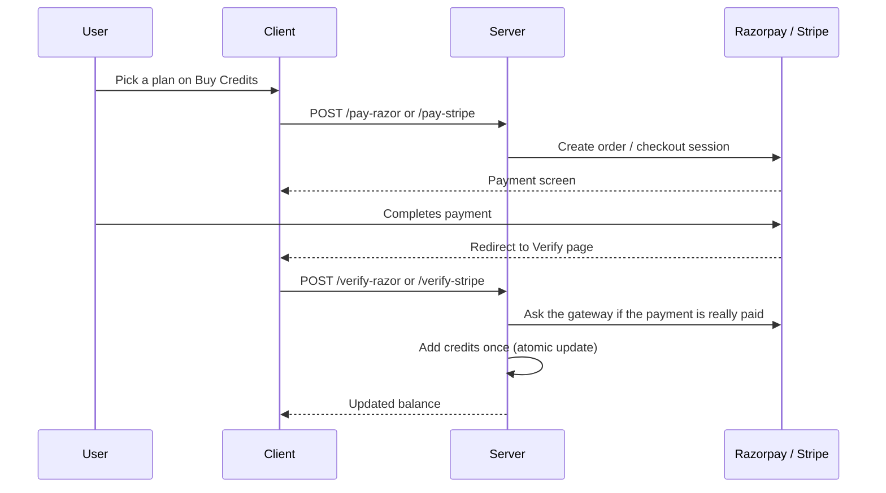

<div align="center">

# 🖼️ ImageHub

### Turn your words into stunning images with AI

A full-stack **text-to-image generator** with secure login, a credit system and online payments.

[](https://react.dev/)
[](https://vitejs.dev/)
[](https://tailwindcss.com/)
[](https://expressjs.com/)
[](https://www.mongodb.com/)
[](https://codespaces.new/adeebmansoor/ImageHub)

**👇 Jump to a section**

[✨ Features](#-features) •
[🧰 Tech Stack](#-tech-stack) •
[🧱 Architecture](#-architecture) •
[🚀 Quick Start](#-quick-start) •
[🔐 Environment](#-environment-variables) •
[🔌 API](#-api-reference) •
[💳 Credits](#-credit-plans) •
[📁 Structure](#-project-structure)

</div>

---

## ✨ Features

- 🎨 **AI image generation:** type a prompt, get an image back in seconds, powered by the Clipdrop text-to-image API
- 🔑 **Secure accounts:** register and log in with bcrypt-hashed passwords and JWT sessions
- 🪙 **Credit system:** every generation costs 1 credit, and your balance is always visible
- 💳 **Two payment gateways:** buy more credits with **Razorpay** or **Stripe**
- ⬇️ **Download results:** save your generated images
- 💫 **Smooth UI:** responsive React interface styled with Tailwind CSS and animated with Framer Motion
- 🔔 **Instant feedback:** toast notifications for every action

<!--
📸 SCREENSHOTS: add your own images here, for example:
<p align="center">
  
  
</p>
-->

---

## 🧰 Tech Stack

<details open>
<summary><b>▶ Frontend (client)</b></summary>

<br>

| Tool | Purpose |
|------|---------|
| React 18 | UI library |
| Vite | Dev server and build tool |
| Tailwind CSS | Styling |
| React Router | Page routing |
| Framer Motion | Animations |
| Axios | API requests |
| React Toastify | Notifications |

</details>

<details open>
<summary><b>▶ Backend (server)</b></summary>

<br>

| Tool | Purpose |
|------|---------|
| Node.js + Express | REST API |
| MongoDB + Mongoose | Database and models |
| JSON Web Tokens | Authentication |
| bcrypt | Password hashing |
| Clipdrop API | Text-to-image generation |
| Razorpay + Stripe | Payments |
| Axios + form-data | Calling external APIs |

</details>

<details>
<summary><b>▶ Deployment</b></summary>

<br>

Both `client` and `server` include a `vercel.json`, so each can be deployed to **Vercel** as its own project.

</details>

---

## 🧱 Architecture

<details open>
<summary><b>▶ How the pieces fit together</b></summary>

<br>



</details>

<details>
<summary><b>▶ What happens when you generate an image</b></summary>

<br>



</details>

<details>
<summary><b>▶ How buying credits works</b></summary>

<br>



</details>

---

## 🚀 Quick Start

<details open>
<summary><b>▶ Run ImageHub locally in 5 steps</b></summary>

<br>

**Prerequisites:** Node.js 18+, a MongoDB database (local or Atlas), and a [Clipdrop API key](https://clipdrop.co/apis). Razorpay and Stripe keys are only needed to test payments.

**1. Clone the repo**

```bash
git clone https://github.com/adeebmansoor/ImageHub.git
cd ImageHub
```

**2. Set up the server**

```bash
cd server
npm install
```

Copy `server/.env.example` to `server/.env` and fill it in using the [variables below](#-environment-variables) (`MONGODB_URI`, `JWT_SECRET` and `CLIPDROP_API` are required), then start it:

```bash
npm run server
```

The API runs on **http://localhost:4000** by default.

**3. Set up the client** (in a new terminal)

```bash
cd client
npm install
```

Copy `client/.env.example` to `client/.env`:

```env
VITE_BACKEND_URL=http://localhost:4000
```

**4. Start the client**

```bash
npm run dev
```

**5. Open the app**

Visit the URL Vite prints, usually **http://localhost:5173** 🎉

> 📄 A step-by-step PDF walkthrough is also included: [How_To_Run_Project.pdf](./How_To_Run_Project.pdf)

</details>

<details>
<summary><b>▶ Available scripts</b></summary>

<br>

| Where | Command | What it does |
|-------|---------|--------------|
| `client` | `npm run dev` | Start the Vite dev server |
| `client` | `npm run build` | Create a production build |
| `client` | `npm run preview` | Preview the production build |
| `client` | `npm run lint` | Lint with ESLint |
| `server` | `npm run server` | Start the API with auto-reload (nodemon) |
| `server` | `npm start` | Start the API with Node |
| `server` | `npm test` | Run the server tests (no database or API keys needed) |

</details>

---

## 🔐 Environment Variables

<details>
<summary><b>▶ Server: <code>server/.env</code></b></summary>

<br>

| Variable | Description |
|----------|-------------|
| `PORT` | Port for the API (defaults to `4000`) |
| `MONGODB_URI` | MongoDB connection string |
| `JWT_SECRET` | Long random string used to sign login tokens |
| `CLIPDROP_API` | Your Clipdrop API key |
| `RAZORPAY_KEY_ID` | Razorpay key ID |
| `RAZORPAY_KEY_SECRET` | Razorpay key secret |
| `STRIPE_SECRET_KEY` | Stripe secret key |
| `CURRENCY` | Payment currency code, for example `INR` or `USD` |
| `CLIENT_URL` | URL(s) of the deployed client, comma separated. Used for CORS and the Stripe redirect. Leave empty for local development |

Example:

```env
PORT=4000
MONGODB_URI=your_mongodb_connection_string
JWT_SECRET=replace_with_a_long_random_string
CLIPDROP_API=your_clipdrop_api_key
RAZORPAY_KEY_ID=your_razorpay_key_id
RAZORPAY_KEY_SECRET=your_razorpay_key_secret
STRIPE_SECRET_KEY=your_stripe_secret_key
CURRENCY=INR
CLIENT_URL=
```

> 🔒 Never commit your `.env` files. They are git-ignored; commit only the `.env.example` templates.

</details>

<details>
<summary><b>▶ Client: <code>client/.env</code></b></summary>

<br>

| Variable | Description |
|----------|-------------|
| `VITE_BACKEND_URL` | URL of the running server, for example `http://localhost:4000` |

</details>

> ⚠️ **Never commit real keys.** Keep `.env` files out of Git and share only placeholder values like the ones above.

---

## 🔌 API Reference

Base URL: `http://localhost:4000`

Protected routes need the login token in a **`token`** request header.

<details open>
<summary><b>▶ User and payment routes</b> — <code>/api/user</code></summary>

<br>

| Method | Endpoint | Auth | Description |
|:------:|----------|:----:|-------------|
| `POST` | `/api/user/register` | ❌ | Create an account, returns a token |
| `POST` | `/api/user/login` | ❌ | Log in, returns a token |
| `GET` | `/api/user/credits` | ✅ | Get your credit balance and name |
| `POST` | `/api/user/pay-razor` | ✅ | Create a Razorpay order |
| `POST` | `/api/user/verify-razor` | ✅ | Confirm a Razorpay payment (checked with Razorpay) and add credits once |
| `POST` | `/api/user/pay-stripe` | ✅ | Create a Stripe checkout session |
| `POST` | `/api/user/verify-stripe` | ✅ | Confirm a Stripe payment (checked with Stripe) and add credits once |

</details>

<details open>
<summary><b>▶ Image routes</b> — <code>/api/image</code></summary>

<br>

| Method | Endpoint | Auth | Description |
|:------:|----------|:----:|-------------|
| `POST` | `/api/image/generate-image` | ✅ | Generate an image from a `prompt` (costs 1 credit) |

**Example request**

```bash
curl -X POST http://localhost:4000/api/image/generate-image \
  -H "Content-Type: application/json" \
  -H "token: YOUR_LOGIN_TOKEN" \
  -d '{"prompt": "a lighthouse on a cliff at sunset, oil painting"}'
```

</details>

---

## 💳 Credit Plans

| Plan | Credits | Price |
|------|:-------:|:-----:|
| 🥉 **Basic** | 100 | 10 |
| 🥈 **Advanced** | 500 | 50 |
| 🥇 **Business** | 5000 | 250 |

One image generation = **1 credit**. The currency is set with the `CURRENCY` variable.

---

## 📁 Project Structure

<details>
<summary><b>▶ Click to expand the file tree</b></summary>

<br>

```text
ImageHub/
├── client/                     # React + Vite frontend
│   ├── public/
│   ├── src/
│   │   ├── assets/             # Icons, logos and sample images
│   │   ├── components/         # Navbar, Header, Steps, Description,
│   │   │                       # Testimonials, GenerateBtn, Login, Footer
│   │   ├── context/
│   │   │   └── AppContext.jsx  # Global state: user, token, credits
│   │   ├── pages/              # Home, Result, BuyCredit, Verify
│   │   ├── App.jsx
│   │   └── main.jsx
│   ├── index.html
│   ├── tailwind.config.js
│   ├── vite.config.js
│   └── vercel.json
│
├── server/                     # Express backend
│   ├── configs/
│   │   ├── mongodb.js          # Database connection
│   │   └── plans.js            # Credit plans (prices live on the server)
│   ├── controllers/
│   │   ├── UserController.js   # Auth, credits and payments
│   │   └── imageController.js  # Image generation
│   ├── middlewares/
│   │   ├── auth.js             # JWT token check
│   │   └── rateLimit.js        # Login and image-generation rate limits
│   ├── models/
│   │   ├── userModel.js
│   │   └── transactionModel.js
│   ├── routes/
│   │   ├── userRoutes.js
│   │   └── imageRoutes.js
│   ├── tests/                  # Payment, credit and auth tests (npm test)
│   ├── .env.example
│   ├── server.js               # App entry point
│   └── vercel.json
│
├── How_To_Run_Project.pdf
└── README.md
```

</details>

---

## 🗺️ Roadmap

- [x] User registration and login
- [x] Text-to-image generation
- [x] Credit balance tracking
- [x] Razorpay and Stripe payments
- [ ] Image history and gallery
- [ ] Prompt suggestions
- [ ] More image styles and sizes

---

## 🤝 Author

**Adeeb Mansoor**

[](https://github.com/adeebmansoor/)

---

<div align="center">

⭐ If you like ImageHub, give it a star!

*Imagine it. Type it. See it.* ✨

</div>
